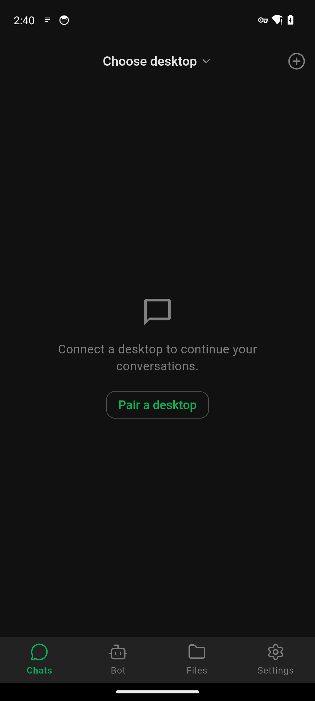
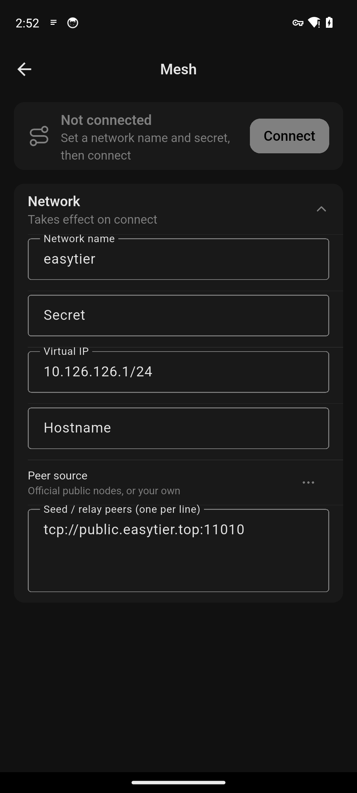

# Fromsko

**English** · [简体中文](README_CN.md)

[Changelog](CHANGELOG.md) · [Releases](https://github.com/Fromsko/fcode/releases) · [Issues](https://github.com/Fromsko/fcode/issues)

Fromsko puts your BaoCode desktop on your phone: follow a running task, answer the agent's
questions, and pick up a conversation where the desktop left it. Pairing uses BaoCode's official
link v2 protocol — iroh/QUIC with Ed25519 keys and end-to-end encryption — so conversations stay
between your phone and your own computer.

It also ships **EasyTier mesh networking**, so a phone and a desktop on different networks can
reach each other directly instead of going through a third-party relay.

| Home | Mesh networking |
| :---: | :---: |
|  |  |

Fromsko is a fork of [YCode](https://github.com/shuishani/ycode) and is not an official BaoCode
product. Model calls, credentials and task execution stay on the desktop. Only connect to
computers you trust.

## Install

1. **Install BaoCode on your computer** — <https://baocode.dev/download>. In the desktop app open
   **Settings → Mobile** to show a pairing QR code.
2. **Install Fromsko** — download the APK from
   [Releases](https://github.com/Fromsko/fcode/releases). Android 7.0+ on arm64. No iOS build.
3. **Pair** — scan the desktop's QR code, paste the address, or let local discovery find it.

## What it does

- Two layouts: **List** (chats, bots, files, settings as four columns) and **Focus** (opens your
  last conversation, everything else in a side panel).
- Chinese and English, following the system or forced light/dark.
- Pair by QR, pasted address or LAN discovery; multiple desktops, automatic reconnect; an
  experimental keep-alive that holds the connection in the background.
- Search, pin and archive projects and conversations; streaming messages, queuing and send-now,
  images, `@` file references, `/` commands.
- Edit an earlier message and resend; revert the files the agent changed after it; context usage
  in the input bar (desktop 1.9.3+).
- Markdown, syntax highlighting, math, offline Mermaid; collapsible tool calls and reasoning,
  approvals, questions, plans, subagents.
- Switch model, mode and permission level; vendor icons; quota display where the desktop
  supports it.
- Bots: create, edit, avatar, memory, chat.
- File tree, search, preview, diff, and keep-or-revert.

### Mesh networking

Open **Settings → Mesh**. Give every device the same network name and secret, then connect. The
app shows each peer's hostname, virtual IP, live round-trip time, whether the link is direct or
relayed, and how much it has sent and received. Tap a peer to probe a TCP port.

Peers default to **EasyTier's official public node** (`tcp://public.easytier.top:11010`). Under
**Peer source** you can reset to the official node, or clear the list and enter your own seed or
relay servers, one per line. Nothing in the app is tied to a particular private network.

## Development

Requires Flutter 3.47 / Dart 3.13, JDK 21, Android SDK and NDK, and Rust 1.97.1 (pinned by
`vendor/bao_iroh/rust/rust-toolchain.toml`). Android only; there is no iOS project.

Local SDK paths go in `android/local.properties`, which is not committed.

```sh
flutter pub get
flutter analyze --no-pub
flutter test --no-pub
flutter run --dart-define=DEMO=true   # demo data, does not connect to a desktop
```

Building, signing and publishing are covered in [docs/release-android.md](docs/release-android.md).
Pushing a `v*` tag runs [`.github/workflows/release.yml`](.github/workflows/release.yml), which
builds, signs and publishes the APK together with the `latest.json` update manifest.

## License and provenance

Fromsko is a derivative work of YCode. Upstream copyright (C) 2026 shuishan. This fork's changes
are released under the same **GPL-3.0-only**; see [LICENSE](LICENSE), and [NOTICE](NOTICE) for the
full list of changes against upstream.

- `vendor/bao_link` and the files adapted from BaoCode are GPL-3.0-only, copyright the BaoCode
  authors. `vendor/bao_iroh` and `vendor/bao_editor` keep their MIT licenses.
- Icons come from Lucide, Remix Icon 4.8.0, theSVG, Simple Icons and Material Icon Theme; see
  [THIRD_PARTY_NOTICES.md](THIRD_PARTY_NOTICES.md). The app lists all of these under
  **Settings → About Fromsko → Open-source licenses**.
- The interface was designed from screenshots of the official BaoCode app; it contains no code or
  image assets from that app. See [docs/upstream-sync.md](docs/upstream-sync.md).
- BaoCode's name and marks, and the model vendors' logos, belong to their respective owners.

## Contributing

Issues and pull requests are welcome — see [CONTRIBUTING.md](CONTRIBUTING.md). Report security
problems privately as described in [SECURITY.md](SECURITY.md).

Never attach model credentials, pairing data, real conversation logs, signing keys or key
passwords to an issue or a pull request.

## Support

If Fromsko is useful to you, you can buy the maintainer a coffee.

<p>
  
  
</p>
