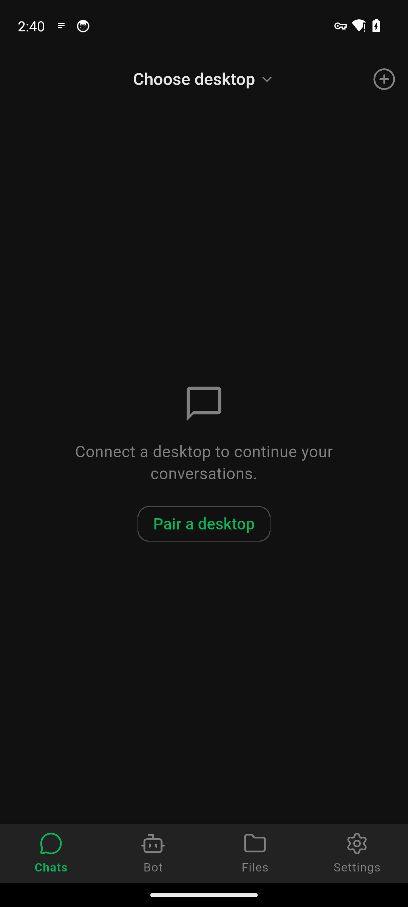
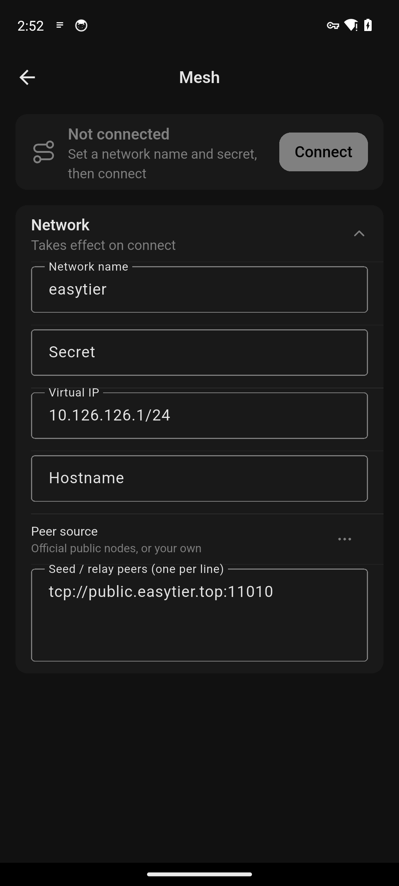

# Fromsko

[English](README.md) · **简体中文**

[更新日志](CHANGELOG_CN.md) · [下载](https://github.com/Fromsko/fcode/releases) · [问题反馈](https://github.com/Fromsko/fcode/issues)

Fromsko 把你的 BaoCode 电脑端搬到手机上：看着任务跑、回答 Agent 的问题、接着电脑上没说完的
对话继续聊。配对走 BaoCode 官方的 link v2 协议——iroh/QUIC、Ed25519 密钥、端到端加密，
对话只在你的手机和你自己的电脑之间。

它还内置了 **EasyTier 组网**，不同网络下的手机和电脑可以直连，不必绕第三方中继。

| 首页 | 组网 |
| :---: | :---: |
|  |  |

Fromsko 是 [YCode](https://github.com/shuishani/ycode) 的分叉，不属于 BaoCode 官方产品。
模型调用、凭据与任务执行都在电脑上。请只连接自己信任的电脑。

## 安装

1. **先在电脑上装 BaoCode**——<https://baocode.dev/download>。在电脑端打开「设置 → 手机」
   显示配对二维码。
2. **安装 Fromsko**——从[发布页](https://github.com/Fromsko/fcode/releases)下载 APK。
   Android 7.0 及以上的 arm64 设备，没有 iOS 版本。
3. **配对**——扫电脑上的二维码，或粘贴地址，或让局域网发现自动找到。

## 功能

- 两种界面模式：「列表」是对话、Bot、文件、设置四栏；「沉浸」直接打开上次的对话，其余收在
  左侧边栏。
- 中英文，跟随系统或强制浅色/深色。
- 扫码、粘贴地址或局域网发现配对；多台电脑、断线自动重连；可开启后台保持连接（实验性）。
- 项目与对话的搜索、置顶、归档；流式消息、排队与立即插入、图片、`@` 文件、`/` 命令。
- 编辑历史消息重发；撤回 Agent 之后改过的文件；输入栏显示上下文用量（需电脑端 1.9.3+）。
- Markdown、代码高亮、数学公式、离线 Mermaid；工具调用与思考可折叠；审批、提问、计划、
  子代理。
- 切换模型、模式与权限；厂商图标；电脑端支持时显示额度。
- Bot：创建、编辑、头像、记忆、聊天。
- 文件树、搜索、预览、改动对比，以及保留或撤回。

### 组网

打开「设置 → 组网」。每台设备填同一个网络名和密钥，然后连接。界面上能看到每个节点的名字、
虚拟 IP、实时往返延迟、是直连还是中继、以及它收发多少流量。点一个节点可以探测某个 TCP 端口
通不通。

节点默认用 **EasyTier 官方公共节点**（`tcp://public.easytier.top:11010`）。在「节点来源」里
可以一键还原成官方节点，也可以清空后自己填种子或中继服务器，一行一个。应用里没有任何写死的
私有网络。

## 开发

需要 Flutter 3.47 / Dart 3.13、JDK 21、Android SDK 与 NDK，以及 Rust 1.97.1（由
`vendor/bao_iroh/rust/rust-toolchain.toml` 固定）。只有 Android 工程，没有 iOS。

本机 SDK 路径写在 `android/local.properties`，不提交。

```sh
flutter pub get
flutter analyze --no-pub
flutter test --no-pub
flutter run --dart-define=DEMO=true   # 演示数据，不连电脑
```

打包、签名与发布见 [docs/release-android.md](docs/release-android.md)。推 `v*` 标签会触发
[`.github/workflows/release.yml`](.github/workflows/release.yml)，自动构建、签名并发布 APK 和
`latest.json` 更新清单。

## 许可与来源

Fromsko 是 YCode 的衍生作品，上游版权归 shuishan 所有，Copyright (C) 2026 shuishan。
本分叉的改动同样按 **GPL-3.0-only** 发布；见 [LICENSE](LICENSE)，相对上游的完整改动清单见
[NOTICE](NOTICE)。

- `vendor/bao_link` 以及改编自 BaoCode 的文件适用 GPL-3.0-only，版权归 BaoCode 作者。
  `vendor/bao_iroh`、`vendor/bao_editor` 保留各自的 MIT 许可。
- 图标来自 Lucide、Remix Icon 4.8.0、theSVG、Simple Icons 和 Material Icon Theme，见
  [THIRD_PARTY_NOTICES.md](THIRD_PARTY_NOTICES.md)。应用内「设置 → 关于 Fromsko → 开源许可」
  也会列出。
- 界面参考官方 BaoCode 应用的截图自行设计，不含该应用的代码或图片素材。来源与对照见
  [docs/upstream-sync.md](docs/upstream-sync.md)。
- BaoCode 的名称与标识、各模型服务商的标志归各自权利人所有。

## 参与贡献

欢迎提交 Issue 和 Pull Request，见 [CONTRIBUTING.md](CONTRIBUTING.md)。安全问题请按
[SECURITY.md](SECURITY.md) 私下报告。

请勿在 Issue 或 PR 里附带模型凭据、配对信息、真实聊天记录、签名密钥与口令。

## 支持

觉得 Fromsko 有用，可以请维护者喝杯咖啡。

<p>
  
  
</p>
